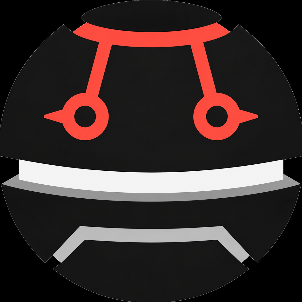

<div align="center">

<p align="center">
  
</p>

# Re-Decoder

**A multipurpose Discord utility bot built with aoi.js 5.1.2**

[](https://aoi.js.org)
[](https://nodejs.org)

[](#-legacy-notice)

[What it is](#-what-it-is) · [Features](#-features) · [Statistics](#-statistics) · [Setup](#-getting-started) · [Legacy notice](#-legacy-notice)

</div>

---

> [!WARNING]
> **Archived codebase.** This is the legacy aoi.js implementation of Re-Decoder. It is preserved for historical reference and learning purposes and is not the current production version. The original source also contains historical credential and infrastructure assumptions, so do not run it unchanged.

## 📖 What it is

Re-Decoder is a multipurpose Discord bot built around **[aoi.js](https://aoi.js.org) 5.1.2**. Its command loader organizes the bot into focused folders for text conversion, Unicode styling, code formatting, server utilities, developer tools, and experimental commands.

The project is intentionally command-driven: each feature is a small JavaScript module loaded from `commands/`, while `index.js` configures the bot, events, variables, status rotation, and command loader.

## ✨ Features

### Text utilities

- Base64 encoding and decoding
- Binary encoding and decoding
- Morse code translation
- Text conversion helpers
- Text-to-speech support

### Text styling

- 50+ Unicode style variations
- Decorative fonts and scripts
- Fraktur, serif, typewriter, comic, manga, and upside-down styles
- Emoji and symbol transformations
- Special text effects

### Code tools

- Base64 and binary text tools
- Morse and text conversion utilities
- Colored code blocks
- Solarized code themes
- Quote formatting
- Developer-friendly formatting helpers

### Server features

- Custom server prefixes
- Interactive help and credits commands
- Suggestions, reports, reviews, and bot information
- Invite and voting utilities
- Prefix reset and server-prefix lookup

### Developer tools

- Command evaluation and Discord.js evaluation
- Command reloading
- Status management
- Server tracking and usage tracking
- Command logging
- Blacklist management
- Automatic leave controls

## 📊 Statistics

| | |
| :--- | :--- |
| **Bot account created** | **20 January 2021 UTC**, derived from the bot snowflake in the archived source |
| **Framework** | aoi.js 5.1.2 |
| **Node.js target** | 16.x |
| **Command modules** | 134 JavaScript files across 7 categories |
| **Prefix** | `re!` by default, configurable per server |
| **Entry point** | `index.js` |
| **Status** | Archived legacy edition |

### Command categories

| Category | Modules | Description |
| :--- | ---: | :--- |
| **Fonts** | 33 | Unicode font conversion and character replacement |
| **Style** | 53 | Decorative text styles and visual effects |
| **Code** | 7 | Encoders, decoders, and text conversion |
| **CodeBlock** | 8 | Code blocks, themes, and quote formatting |
| **Misc** | 13 | General utility and information commands |
| **Dev** | 8 | Developer and maintenance commands |
| **Special** | 12 | Experimental and miscellaneous transformations |
| **Total** | **134** | Loaded from the `commands/` directory |

## 🗂 Project structure

```text
commands/
├── Code/          # Encoders, decoders, and conversion tools
├── CodeBlock/     # Code block and theme generators
├── Dev/           # Developer and maintenance commands
├── Fonts/         # Unicode fonts and text transformations
├── Misc/          # General utility commands
├── Special/       # Experimental transformations
└── Style/         # Decorative text styles
database/
└── main/          # Database schema files
db backup/
└── README.md      # Archive note for database backups
index.js           # Bot setup and command loader
package.json       # Dependencies and npm start script
```

The public repository does not include the historical database backup contents.

## 🚀 Getting started

Install the declared dependencies:

```bash
npm install
```

Start the legacy bot:

```bash
npm start
```

The package targets Node.js 16.x. Before running any historical bot code, replace credentials with environment variables, review every external endpoint, and use a disposable test application and server.

## 🕰 Timeline and date notes

- **20 January 2021 UTC** - the bot account snowflake embedded in the archive dates to this day.
- **2021-2022** - the archive contains Discord snowflakes from this period, reflecting guild, channel, message, and user records used by the bot.
- **2026** - the legacy source was preserved in this public repository for reference.

Discord snowflake dates identify when Discord objects were created; they do not prove that every command was written on the same date. The original Git history is not present in this archive, so the bot-account date is the most reliable project anchor available in the source.

## 🧱 Legacy notice

This repository preserves the original aoi.js version of Re-Decoder before the project migrated to discord.js v14. It remains available for:

- Historical source preservation
- Studying an aoi.js command-loader project
- Learning from older Discord bot patterns
- Reviewing the evolution of Re-Decoder

The modern implementation is separate. This legacy edition should be treated as an archival snapshot rather than a maintained deployment.

## 🔐 Security notes

The archived source was written for a live bot and includes historical operational assumptions. If you reuse it:

- Never commit a Discord bot token or API key.
- Rotate any credential that has ever appeared in a public archive.
- Move secrets to environment variables before testing.
- Review hardcoded channel, message, server, and user IDs.
- Do not expose evaluation commands on a shared or production bot.
- Test only with a disposable Discord application and server.

## 📄 License

The project metadata declares the **MIT License**. See `package.json` for the repository's current license declaration.

<div align="center">
<sub>Re-Decoder Legacy Edition - preserved for reference.</sub>
</div>
